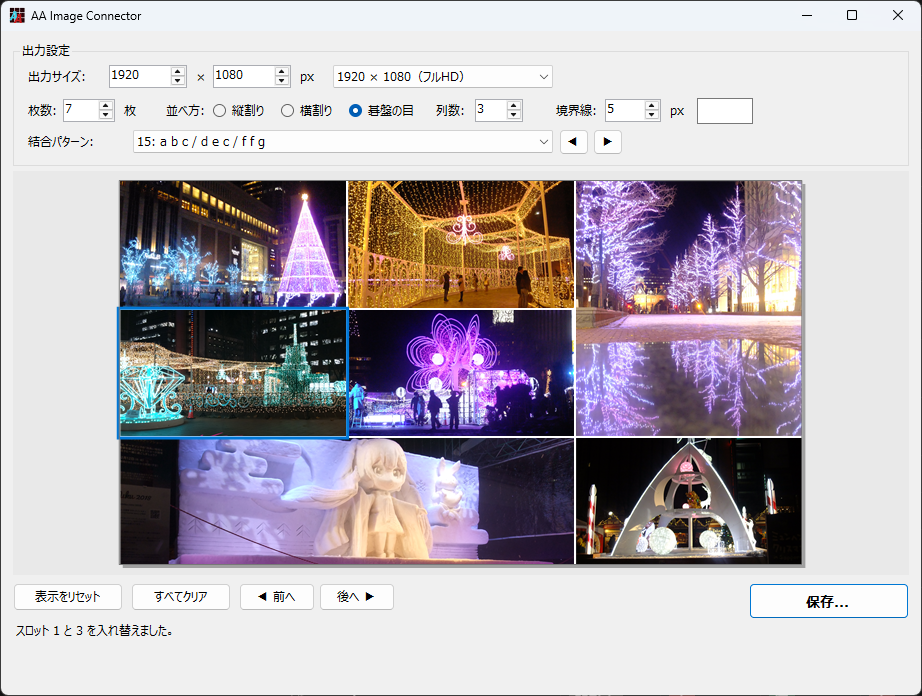

# AA Image Connector

複数の画像を1枚の画像に結合するツール。並べて結合する枚数・並べ方・境界線の太さと色を指定でき、スロット内で画像の拡大縮小・移動ができます。

## 機能

- インストール不要、配布zipファイルを解凍するだけでポータブル動作（exeファイル単独で動作）
- 出力サイズ（幅×高さ px）を自由に指定。プリセット（フルHD／HD／正方形／縦長／縦フルHD／800×800）あり
- 並べて結合する枚数を 1〜20 枚から選択
- 並べ方を「縦割り」「横割り」「碁盤の目」から選択（碁盤の目は列数指定可）
- 画像同士の境界線の太さ（0px〜）と色を指定可能
- 各スロットでマウスホイールによる拡大／縮小、右ドラッグによる画像の移動が可能
- 余ったマスは「結合パターン」として全パターンを列挙し、コンボボックス／◀ ▶ ボタン／分割線のドラッグで切り替え可能
- 左ドラッグでスロットの入れ替え

## 動作環境

- Windows 10 / 11
- .NET Framework 4.x（OS 標準搭載）

## 手元でビルドする場合の方法

1. `AA_Image_Connector.cs`、`BuildExe.bat`、`app.ico` を同じフォルダに置く
2. `BuildExe.bat`をダブルクリック
3. `AA_Image_Connector.exe`が生成される

（`app.ico`が無くてもビルド可能）

## 使い方

### 基本の流れ

1. `AA_Image_Connector.exe` を起動
2. 上部の「出力設定」で以下を指定
   - **出力サイズ** … 生成する画像の幅と高さ（px、1〜10000）。プリセットあり
   - **枚数** … 並べて結合する画像の枚数（1〜20枚）。初期値 2枚
   - **並べ方** … 「縦割り」「横割り」「碁盤の目」。碁盤の目を選ぶと <列数>（1〜10列）の指定欄が出現
   - **境界線** … 画像同士の境界線の太さ（0px〜100px）と色（初期値 4px・白）
3. プレビュー内の各スロットをクリックするか、画像ファイルをスロット／ウィンドウにドラッグ＆ドロップして読み込み
4. 「保存...」を押して PNG または JPEG（品質92）で保存

### スロットの操作

- **空のスロットをクリック** … 画像を選択するダイアログを開く
- **画像読み込み済みのスロットをダブルクリック** … 画像を選択し直すダイアログを開く
- **画像読み込み済みのスロットを左クリック** … スロットを選択（青い枠で強調表示）
- **マウスホイール** … 拡大／縮小（カーソル位置を中心。0.05〜30.0倍）
- **右ドラッグ** … 画像を移動（パン）
- **左ドラッグ** … スロットの入れ替え
  - 碁盤の目でマスが余る時は、画像がある場所のドラッグで入れ替え、分割線のドラッグで結合位置の切り替え
- **右クリック** … メニュー（このスロットの表示をリセット／画像を削除／前・次のスロットと入れ替え／すべての表示をリセット）

### 碁盤の目でマスが余る場合（例: 4枚・3列）

6マスに対し4枚しかスロットがない場合、余った2マスをどう結合するかを「結合パターン」として全パターン列挙し、選べます。どのパターンでも全マスを画像で埋められます。

- 選択方法
  - **結合パターン** コンボボックス（`a〜` はスロットの割り当てを表現）
  - **◀ ▶** ボタン
  - **分割線**（境界線上のカーソルが ↔ / ↕ に変化）を左ドラッグ。掴んだ線が結合になり、ドロップ先の結合内部の線が分割される
- 例
  - `a b c / d d d` … 下段が3マス横結合（初期表示）
  - `a b b / c d d` … 上段右＋下段右の2マスずつ結合（2マス＋2マス）
  - `a b c / a d d` … 左列が縦に2マス結合、下段が横に2マス結合、など
- 縦・横一直線のスパン（矩形）に限定、L字型の結合には非対応
- ドラッグ後は左上から順に `a〜` のラベルが振り直されるため、画像の並びも変化する

### その他

- 「**表示をリセット**」… 全スロットのズーム・パン位置を初期化
- 「**すべてクリア**」… 全スロットの画像を消去
- 「**◀ 前へ**」「**後へ ▶**」… 選択中のスロットを隣のスロットと入れ替え（画像・ズーム・パン位置ごと）
- 未設定のスロットがある状態で保存しようとすると、保存前に確認メッセージを表示（空のスロットは薄いグレーで出力）

## アンインストール

アンインストールは exe ファイルを削除するだけです（レジストリ不使用・動作時に生成されるファイルなし・設定ファイルの保存なし・ネットワークアクセスなし）

## スクリーンショット

## ライセンス

MIT License — 詳細は [LICENSE](LICENSE) を参照。

## クレジット

- 本ツールの開発過程で生成AIを利用しています。
